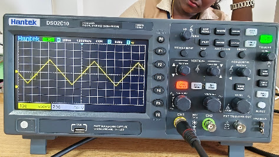

# Interfacing the Internal DAC with STM32F407VET6

Experiment 11 on the **LOGSUN STM32 M4 DVK** (ARM Cortex-M4): generating an analog waveform from the on-chip 12-bit DAC and verifying it on a Digital Storage Oscilloscope (DSO).

## Aim
Interface the internal DAC of the STM32F407VET6 and observe the analog output on a DSO.

## Components and Tools

| Type | Item |
|------|------|
| Hardware | STM32 M4 DVK board (STM32F407VET6, Cortex-M4) |
| Hardware | 12V power adapter |
| Hardware | USB cable (PC to board) |
| Instrument | Digital Storage Oscilloscope (DSO) with probe |
| Software | Keil µVision IDE (Keil.STM32F4xx_DFP 2.13.0 pack) |
| Software | ST Flash Loader Demonstrator |

## Pin Description
| Signal | Pin |
|--------|-----|
| DAC output | PA4 (DAC channel 1) |
| Ground | GND of the DAC section |

## Procedure
1. Connect the 12V adapter and the USB cable (PC to board).
2. Build the project in Keil µVision with **Create HEX File** enabled.
3. Open Flash Loader Demonstrator: UART, 115200 baud, 8 data bits, even parity, echo disabled.
4. Set the **Boot Config switch (SW3)** to **System** mode, press **RESET**, then click **Next**.
5. Select target `STM32F4_05_07_15_17_1024K`, choose **Download to device**, pick the `.hex` file, select **Erase necessary pages**, and click **Next**.
6. After "Download operation finished successfully", set the Boot Config switch to **Flash** and press **RESET**.
7. Connect the DSO probe between **PA4** and **GND** of the DAC section.
8. The waveform appears on the DSO.

## Repository Structure
```
.
├── README.md
├── .gitignore
├── src/
│   └── main.c
└── images/
    └── dso_output.jpg   (add your DSO photo here)
```

## Output
Add your DSO screenshot or photo here:



## Result
The internal 12-bit DAC successfully converted digital values to an analog waveform, observed on the DSO.

## Author
Prathyumnan, ECE student
